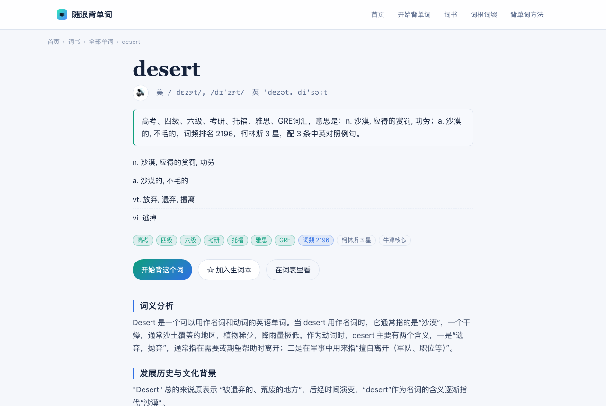
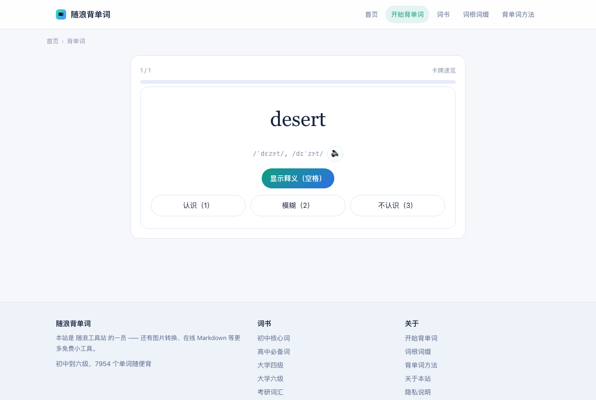

# Vocab4U · 随浪背单词

> 免费、免登录、零广告的英语背单词站。**7954 个词条 + 5599 个词形变化页**，每个词都有音标、中文释义、
> 中英对照例句、词根词缀、文化背景、单词变形、记忆方法和一个带翻译的小故事。

**在线使用：<https://vocab4u.suilang.net>**


这个仓库是它的**全部源码和成品数据**：生成器、前端、词典 JSON。克隆下来跑两条命令，就能得到一个一模一样的站。

## 截图

| 词条页 | 学习器 |
| --- | --- |
|  |  |

## 有什么

**每个词条都长这样**（不是只给个中文释义就完事）：

- 音标（美 / 英）、中文释义、词频排名、柯林斯星级、牛津核心标记
- 考试分级标签：中考 / 高考 / 四级 / 六级 / 考研 / 托福雅思 GRE
- 3 到 6 条**中英对照**例句，每条都能单独朗读、也能拿来练打字
- 词义分析、词根分析、词缀分析、发展历史与文化背景、单词变形、记忆辅助
- 一个用这个词写的**小故事**，同样带中文翻译

**词形变化页**：`went`、`studying`、`children` 这类变形也各有一页，写清它是哪个词的什么形态，
并列出本站例句里真的用到这个形态的句子。词形是从 ECDICT 的 `exchange` 字段拆出来的，
但**只有在本站例句和小故事里真的出现过的词形才建页** —— 变形是程序生成的，
一万多个全建页在搜索引擎眼里就是一堆空壳子，宁可少而实。

**形近词**：每个词条下面列出拼写相近、容易记混的几个词（`desert` → `dessert`、`desire`、`deserve`…）。
算法是首字母相同 + 长度差 ≤ 2 + 编辑距离 ≤ 2，排序按拼写距离优先。

**学习器五种练法**，全程键盘可操作（空格发音、回车提交、数字键选答案）：

| 模式 | 练什么 |
| --- | --- |
| 卡牌速览 | 认不认识，自己打分 |
| 打字默写 | 看中文敲英文 |
| 听写辨词 | 听发音敲单词 |
| 例句填空 | 在真实句子里填词 |
| 选择题 | 四选一 |

**其他**：

- 学习记录存在浏览器本地（Leitner 盒 + ease，间隔 1/2/4/7/15/30/60 天），关掉网页还在，可以导出导入
- 发音双通道：单词优先用有道真人发音，失败自动回落到浏览器语音；例句用浏览器语音
- PWA，能装到桌面/手机主屏，离线也能背
- 纯静态，没有后端、没有数据库、没有账号体系

## 数据

`data/` 里是成品数据，可以直接拿去用（也可以只拿这部分，不管前端）：

| 文件 | 大小 | 内容 |
| --- | --- | --- |
| `data/dictionary.json` | 23 MB | 7954 个词条：`word` / `slug` / `us` `uk` 音标 / `trans` 中文释义 / `tags` 分级 / `frq` `bnc` `collins` `oxford` 词频星级 / `exchange` 变形 / `sections` 八节正文 / `sentences` 中英例句 / `story` 中英小故事 / `books` 所属词书 |
| `data/forms.json` | 1.7 MB | 12335 个词形 → 原词、词性代码、音标、中文释义、**在本站语料里出现过几次** |
| `data/books.json` | 0.4 MB | 7 本词书的词表（初中 / 高中 / 四级 / 六级 / 考研 / 出国 / 全部） |
| `data/roots.json` | 54 KB | 288 条词根词缀，每条至少配 3 个本站例词 |

`data/forms.json` 里有个字段值得单独说：**词频只能用「本站语料出现次数」，不能信 ECDICT 的 `frq`**。
ECDICT 里 `went`、`did`、`children` 的 `frq` 全是 0，而 `berried`、`bluing` 是 47000+，完全不可用。

## 目录结构

```
├── assets/          前端：config.js（唯一配置入口）、style.css、dict.js、learn.js
├── build/           Python 生成器
│   ├── 上游数据.py   上游数据下载与读取（ECDICT / ipa-dict）
│   ├── 解析词条.py   上游 Markdown → 八节结构化正文 + 例句中英分离
│   ├── 取数据.py     合成 data/ 下的成品数据
│   ├── 文案_教程.py  四篇教程正文
│   ├── gen.py       整站生成器：13990 个页面 + sitemap + llms.txt + 分享图
│   └── 预览服务器.py 本地预览（按 Cloudflare 的 html_handling 规则找文件）
├── data/            成品数据
├── docs/            设计文档
└── scripts/         双击就能用的脚本（本地预览 / 重新上线）
```

## 本地跑起来

只依赖 Python 3，没有第三方库：

```bash
python3 build/gen.py           # 生成整站，约 10 秒
python3 build/预览服务器.py 8848   # 打开 http://127.0.0.1:8848
```

`data/` 里已经有成品数据，**不用先跑取数据**。只有想从上游重新拉一遍时才需要：

```bash
python3 build/取数据.py        # 会下载几十兆到 build/_raw/，然后重写 data/
python3 build/test_取数据.py   # 数据验收（词数、音标覆盖率、词根条数）
python3 build/test_解析词条.py # 解析器抽样验收
```

生成物（`w/`、`list/`、`sitemap.xml` 等）不进 Git，改文案改生成器，别手改 HTML。

## 部署

纯静态，Cloudflare Workers 静态资源 / GitHub Pages / 任何静态托管都能放。
改 `wrangler.jsonc` 里的 `name` 和 `routes` 成你自己的，然后：

```bash
npx wrangler deploy
```

域名、站名、统计、站长验证全在 `assets/config.js` 一个文件里，生成器直接读它，不用满站改。
换域名时改这一处 + 重新生成即可（生成器会更新全站 canonical、sitemap 和结构化数据）。

## 数据来源与授权

- 词义、例句、词根词缀、文化背景、记忆方法、小故事：由 [DictionaryByGPT4](https://github.com/Ceelog/DictionaryByGPT4)
  整理，原作以 CC BY-SA 4.0 发布
- 音标、中文释义补充、词频、柯林斯星级、考试分级：[ECDICT](https://github.com/skywind3000/ECDICT)（MIT）
- 音标兜底：[ipa-dict](https://github.com/open-dict-data/ipa-dict)（MIT）
- 词根词缀表：ECDICT `wordroot.txt`（MIT）

代码本身以 MIT 授权（见 `LICENSE`）。词条内容转载时请保留上面的出处。

## 反馈

词条内容有错、或者想加功能，欢迎开 Issue。站点本身不收集任何用户数据，学习记录只存在你自己的浏览器里。
